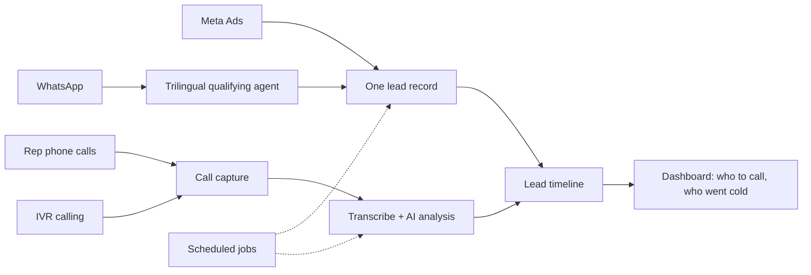

# ReliveCure — Clinic Lead Platform

**Freelance work for a LASIK clinic in India.** I scoped and built the platform end to end. It's live in production, and the company's internal team runs and extends it now.

I was the freelancer on it, not the owner — I don't own, operate or run the clinic.

---

## The problem

The clinic was buying leads from Meta Ads and losing them in the gap between channels.

1. **Nobody knew what a lead was.** The same person could arrive as an ad form, a WhatsApp message and a phone call, and become three records. Follow-up went to whoever happened to see one of them.
2. **Qualification was a person's whole morning.** Every WhatsApp thread needed a human to pull out age, prescription, insurance and intent before anyone could decide whether the lead was worth a call.
3. **Calls were invisible.** Reps called from their own phones. What was said, whether it connected, and what the patient actually objected to existed nowhere the business could see.
4. **"Did we call them?" had no answer.** No one could say which of this month's leads had been contacted, how fast, or which ones had gone cold.

---

## What I built

A single system that captures every inbound lead, qualifies it, captures the conversation, and puts all of it on one timeline per person.

- **One record per person.** I designed the data model and the matching rules that collapse ad leads, WhatsApp threads and call logs onto a single person, instead of three half-filled rows.
- **A trilingual WhatsApp agent** (Hindi, Hinglish, English) that qualifies inbound before a rep spends time on it, and hands over to a human cleanly when it should.
- **Call capture, including the reps' own phones** — an Android app, plus IVR calling — so conversations that used to vanish became records.
- **Transcription and AI analysis on every recording,** so the business can see what was said and why deals were lost, not just that a call happened.
- **A lead timeline** that holds messages, calls, analysis and status changes in one place, and a dashboard built on top of it that answers who to call next and who has gone cold.
- **Scheduled jobs for the recurring work** — intake, matching, transcription, analysis and reporting run on a timer, so the pipeline keeps moving without anyone pressing a button. I use Cursor agents in the development loop to build and maintain those jobs.

---

## What it resolved

| Before | After |
|--------|-------|
| One person could exist as three unlinked records | One record per person, matched across ads, WhatsApp and phone |
| Every WhatsApp thread qualified by hand | Qualified automatically before a rep is involved; humans take over by exception |
| Rep phone calls left no trace | Every call captured, transcribed and analysed onto the lead |
| No answer to "did we call them, and how fast?" | Contact rate and speed-to-lead reportable per month |
| Loss reasons were anecdote | Loss reasons come out of the actual call content |

---

## How much it helped

System usage as of **3 November 2026**. These measure use of what I built — they are not results I drove, and nothing here implies causality.

| | |
|---|---|
| Leads / records | **10,880+** (~10,850 distinct people) |
| Growth in new leads per month | **931 in June → 1,895 in October** |
| Raw call rows deduped to unique calls | **~128,000 → ~98,000** |
| Calls matched to a lead | **90.7%** |
| Connected calls | **31,288** (~780 hours of talk time) |
| Recordings captured / transcribed / AI-analysed | **26,333 / 15,406 / 13,700+** (7,207 analysed in October alone) |
| WhatsApp | **2,300+ leads · 16,360 messages** |
| Timeline events | **100,000+** |
| Reps · devices | ~12–15 reps · 31 devices |
| October contact coverage | Of 1,895 new leads, **96% were called** and **86% within 24 hours** |

Two of those matter more than the rest. The 90.7% match rate says the record model holds up against messy real-world data. The October coverage says the follow-up discipline it enables is actually happening.

---

## Stack

Android call-capture app (Kotlin, Jetpack Compose) · Node.js · PostgreSQL · React dashboard · Gemini · WhatsApp Cloud API · scheduled jobs · hosted on Railway.

Built with Cursor agents in the development loop. I own the decisions and review every output.

---

## The dashboard

*Funnel, lead health distribution, rep performance and loss analysis. Identifiers redacted; counts are from an earlier snapshot.*

---

## What made it work

**The hard part was identity, not AI.** Deciding when two phone numbers are the same person — and being willing to be wrong in the safe direction — is what made every number above possible. AI analysis is only worth anything if it attaches to the right record.

**Capture beat cleverness.** The single biggest change wasn't a model. It was getting rep calls out of their personal phones and into the system at all.

**It was built to be handed over.** It runs without me now, which was always the point.

---

## Handover

Built by me as a freelancer, then **handed over to the company's internal team**, who run and extend it. They operate it as a consultation platform on an aggregator model.
